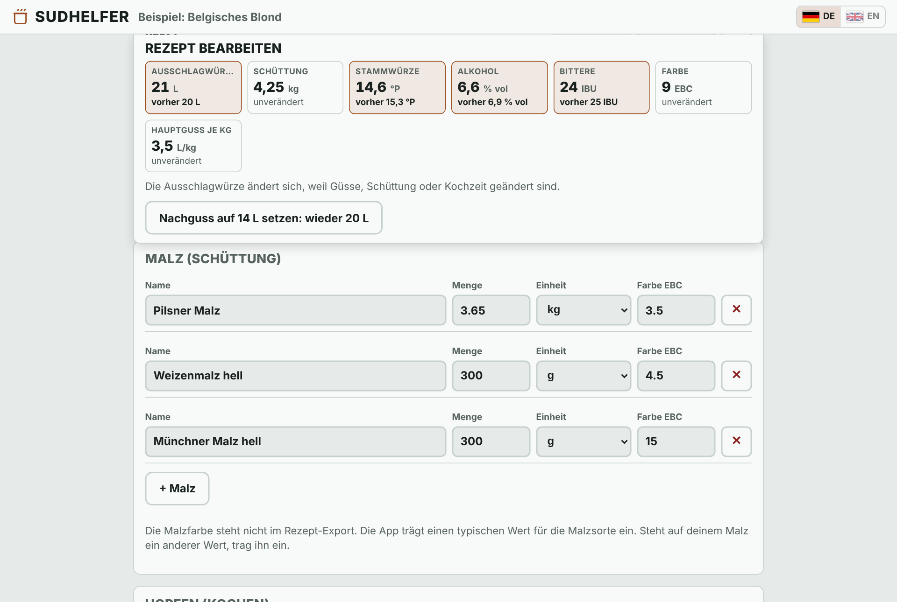
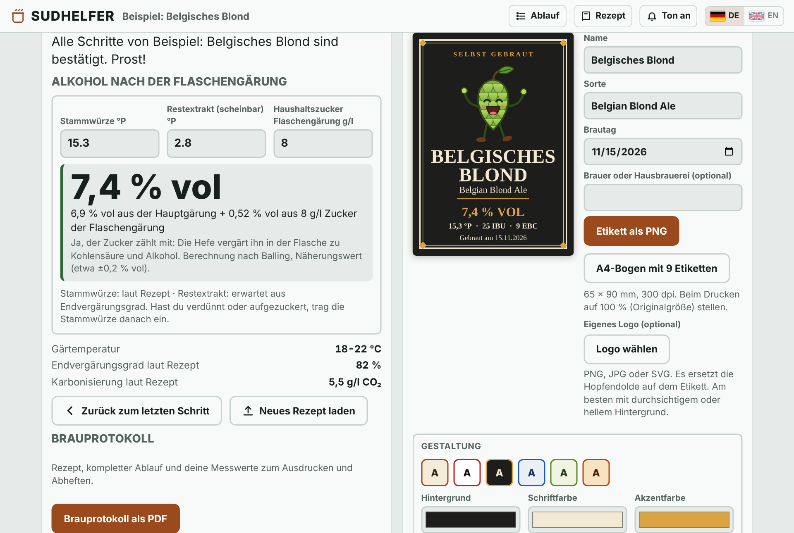
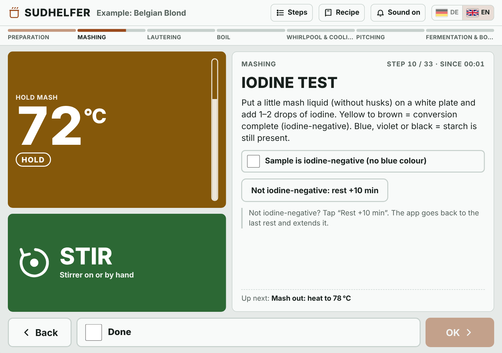

# Sudhelfer

🇩🇪 [Deutsch](README.md) · 🇬🇧 **English**

Web apps that guide homebrewers step by step through a brew day with a simple electric kettle (the German "Einkochtopf" setup): from mashing in to bottling. They read recipes from [maischemalzundmehr.de](https://www.maischemalzundmehr.de/) as well as BeerXML and BeerJSON files and turn them into an unambiguous sequence with a large target temperature display, a stirring indicator, timers and a confirmation for every step.

There are two variants. Both run on laptops, tablets and phones, can be added to the home screen on iPhone, iPad and Android, and then also work offline. They store their data separately.

| | **Sudhelfer Einkochtopf** | **Sudhelfer Plus** |
|---|---|---|
| Online | **[danielmenzel.de/sudhelfer](https://danielmenzel.de/sudhelfer/)** | **[danielmenzel.de/sudhelfer-plus](https://danielmenzel.de/sudhelfer-plus/)** |
| Language | German | German and English, switch at the top right |
| Recipe | load and scale to your batch size | also edit and save |
| Label | fixed design | your own logo, colours, typeface, frame, size |
| Source code | this directory | [`plus/`](plus/) |

> **Note:** Sudhelfer is a private hobby project. It is not affiliated with maischemalzundmehr.de and is not an official offering of that site. The recipes belong to their respective authors.

**If you want English, use Sudhelfer Plus.** The rest of this page describes it; the classic variant has the same brewing workflow in German only.

## What Sudhelfer Plus does

- **Load recipes**
  - JSON export from maischemalzundmehr.de (export versions 1 and 2, including decoction)
  - photograph the QR code of a recipe page on maischemalzundmehr.de; the app then leads you to the matching JSON export
  - BeerXML 1.0 (e.g. from BeerSmith, Brewfather, Kleiner Brauhelfer, Brewer's Friend)
  - BeerJSON 1.0
- **Overview:** key figures, phases, mash schedule chart, boil schedule with addition times. Batch volume and brewhouse efficiency are set in one place and the whole recipe is converted.
- **Edit the recipe:** change, remove or add malts, hops, other additions, dry hops, fermentation additions and mash rests. Batch volume, original gravity, alcohol, bitterness and colour are recalculated continuously and shown as "was → now".
- **Dependencies:** the batch volume follows the water balance (strike water + sparge water − spent grain loss − evaporation).
- **Alpha acid:** if your hops have a different alpha acid value than the recipe, the app adjusts the amount in grams so that the bitterness stays the same.
- **Save the recipe** as a JSON file that can be loaded again. The original can be restored.
- **Brew mode:** large target temperature with a hint what to do (heat, hold, boil, cool, off), stirring indicator, timers with sound, every step confirmed with a tick and OK, going back possible at any time. A click on "Sudhelfer" at the top left aborts the brew.
- **All the way to the end:** preparation, mashing with iodine test, lautering, boil, whirlpool, cooling without active chilling, pitching, primary fermentation, dry hopping, final attenuation, bottling, bottle conditioning.
- **Calculators:** original gravity with temperature correction and Pearson square (dilute or raise the gravity), priming sugar for bottle conditioning, alcohol content after bottle conditioning.
- **Output:** brew log as a PDF, bottle label as a PNG (single or A4 sheet) with your own logo, colour presets and free colours, typeface and sizes, eight frames, label size and number per sheet.
- Progress, timers and inputs are stored in the browser. Reloading the page is safe.

Units are metric (°P, litres, kg, g/l, EBC).

**Edit recipe** with continuously recalculated values (German interface shown):

**Design the label:**

**English interface** in brew mode:

The calculations (original gravity from the extract balance, bitterness by Tinseth, colour by Morey, alcohol by Balling) are approximations and are calibrated on the loaded recipe. Malt colours are not part of the recipe export; the app fills in typical values that you can overwrite.

## How to use it

### iPhone and iPad

1. Open [danielmenzel.de/sudhelfer-plus](https://danielmenzel.de/sudhelfer-plus/) in **Safari**.
2. Tap **Share** (square with an arrow pointing up), then **"Add to Home Screen"** and **"Add"**.
3. Open Sudhelfer once from the new icon while online. From then on it also starts without a connection, for example in the garage or the cellar.

Good to know:

- The downloaded file `sudhelfer-plus.html` does **not** work on iPhone and iPad. iOS only shows local HTML files in a preview without JavaScript, so the page stays empty. Use the link above instead.
- The screen stays on during a brewing step. For the timer sound, tap **"Sound on"** at the top and check the mute switch of the device.
- The home screen app and Safari store their data separately. A brew started in Safari is not visible in the home screen app. Always use the same one.
- Before your first brew day, test once in flight mode whether Sudhelfer starts.

### Android

1. Open [danielmenzel.de/sudhelfer-plus](https://danielmenzel.de/sudhelfer-plus/) in **Chrome**.
2. In the menu (three dots) choose **"Add to Home screen"** or **"Install app"**.
3. Open it once while online; after that it also runs offline.

### Laptop and PC

- Either open the online version in the browser
- or download the HTML file and open it with a double click. Each variant is a single file that runs completely offline:
  - **[Download sudhelfer-plus.html](https://github.com/Zebrazeh/sudhelfer/releases/latest/download/sudhelfer-plus.html)** (Sudhelfer Plus)
  - **[Download sudhelfer.html](https://github.com/Zebrazeh/sudhelfer/releases/latest/download/sudhelfer.html)** (Sudhelfer Einkochtopf, German)

### Brewing

1. Load a recipe: choose a file, paste the text or scan the QR code.
2. Check the overview, read the notes on the recipe, tap **Start**.
3. Work through every step, tick it off and confirm with **OK**.

To try things out, the app loads an example recipe put together for this purpose (Belgian Blond) on first start. More example files are in [`examples/`](examples/).

## Safety

Bottle conditioning can be dangerous: too much sugar or beer that has not fermented out builds up too much pressure in the bottle, and bottles can burst. Recipes on recipe sites are unverified hobby recipes and may contain errors. All values in the app are approximations without warranty. **You brew at your own risk.**

## Privacy

Recipes, readings and progress stay in the browser on your device. The app sends nothing to a server and loads nothing from third-party addresses. The only exception is the link "Open JSON export" to maischemalzundmehr.de, which you tap yourself. For the online version at danielmenzel.de, the legal notice and privacy policy linked in the app apply (in German).

## Source code layout

| File | Content |
|---|---|
| `index.html` | Sudhelfer Einkochtopf as a single file, generated by `build.py` (the same file as the download) |
| `src/app.html` | interface, styles, calculators, PDF and label generation |
| `src/core.js` | recipe import (maischemalzundmehr.de, BeerXML, BeerJSON) and generation of the brewing steps |
| `vendor/jsQR-1.4.0.js` | QR recognition, included unchanged |
| `web/` | extra files for the online version: service worker (`sw.js`) for offline use, manifest and icons for the home screen |
| `build.py` | assembles the app from its parts |
| `examples/` | example recipes in all three formats |
| `plus/` | Sudhelfer Plus: its own source code (`src/`), its own `build.py`, its own service worker and manifest (`web/`), the finished app as `plus/index.html`. QR recognition and icons are shared from `vendor/` and `web/`. |

**Build a single file:** `python3 build.py` creates `index.html`; `python3 plus/build.py` creates `plus/index.html`.

**Build your own online version:** `python3 plus/build.py --web TARGETFOLDER --legal-url https://example.org/legal` creates `index.html`, `sw.js`, `manifest.webmanifest` and three icons in the target folder. Put these six files together into one folder on your own web space. The web space needs **HTTPS**, otherwise offline use and "keep the screen on" do not work. `--legal-url` adds a link to your legal notice in the app. Upload all six files again for every new version. Each variant needs its own folder.

## Licence

© 2026 Daniel Menzel. Published under the [MIT licence](LICENSE). Created with the help of Claude (Anthropic).

Third-party software included: [jsQR](https://github.com/cozmo/jsQR) 1.4.0 under the Apache License 2.0, see [THIRD-PARTY-NOTICES.txt](THIRD-PARTY-NOTICES.txt).
