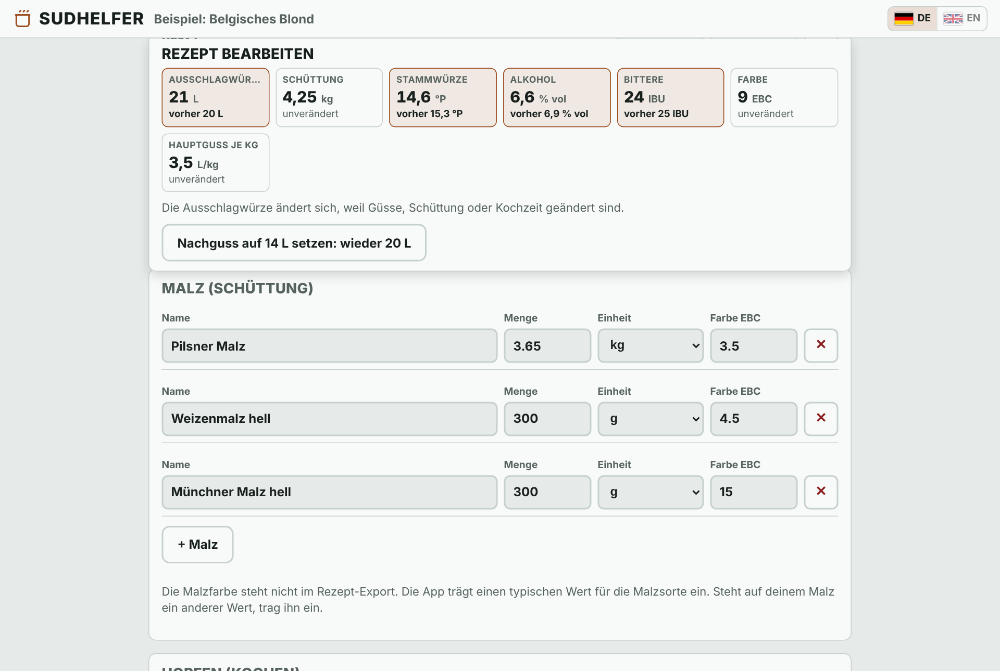
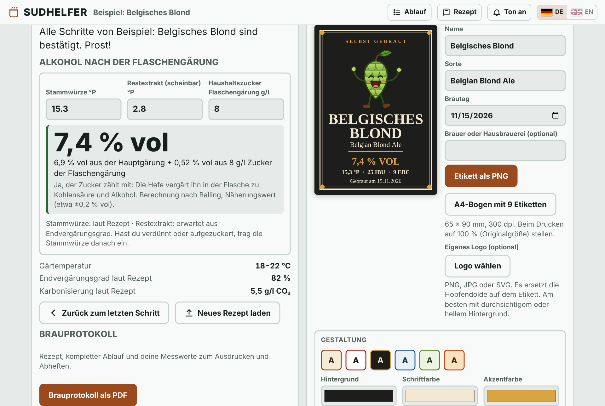
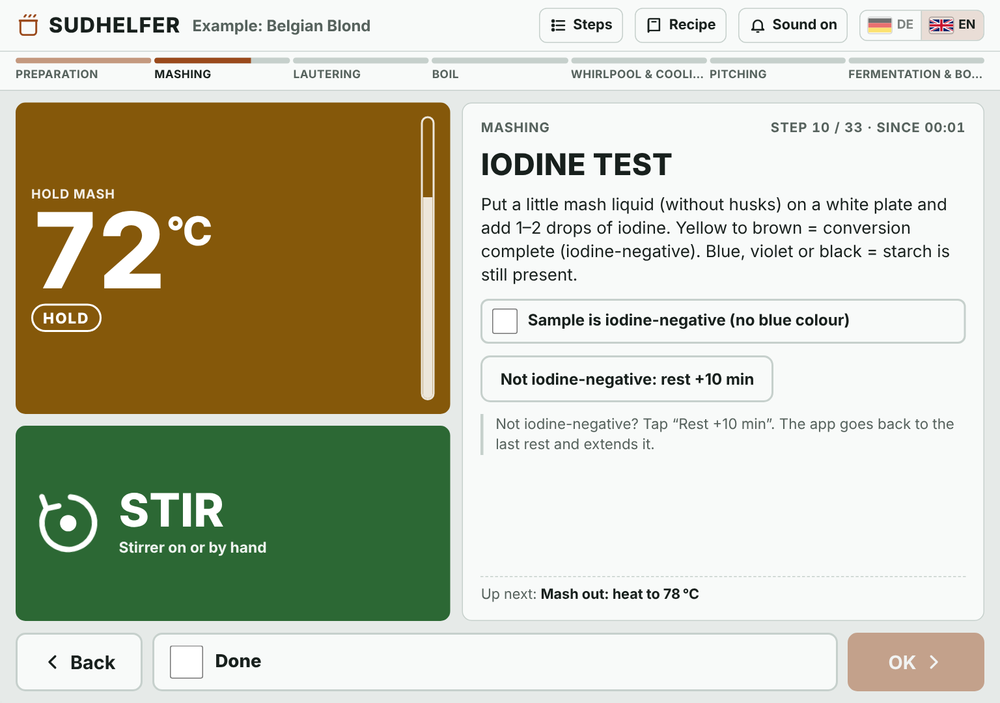
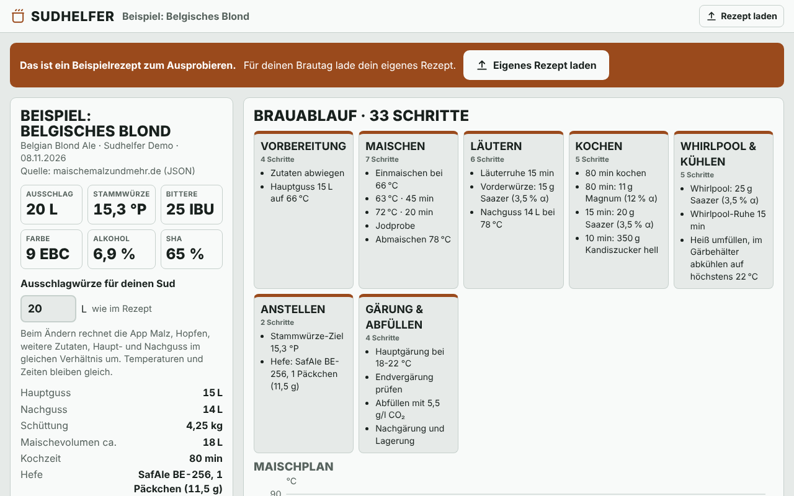
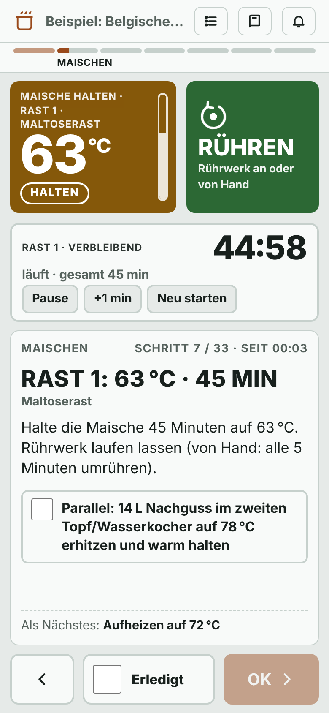
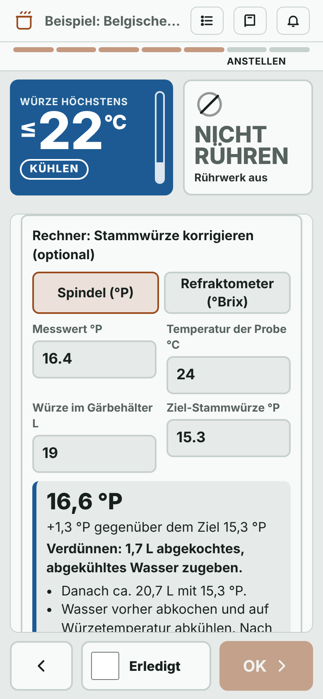
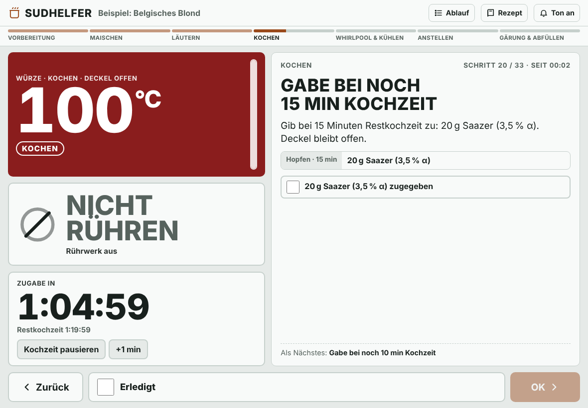
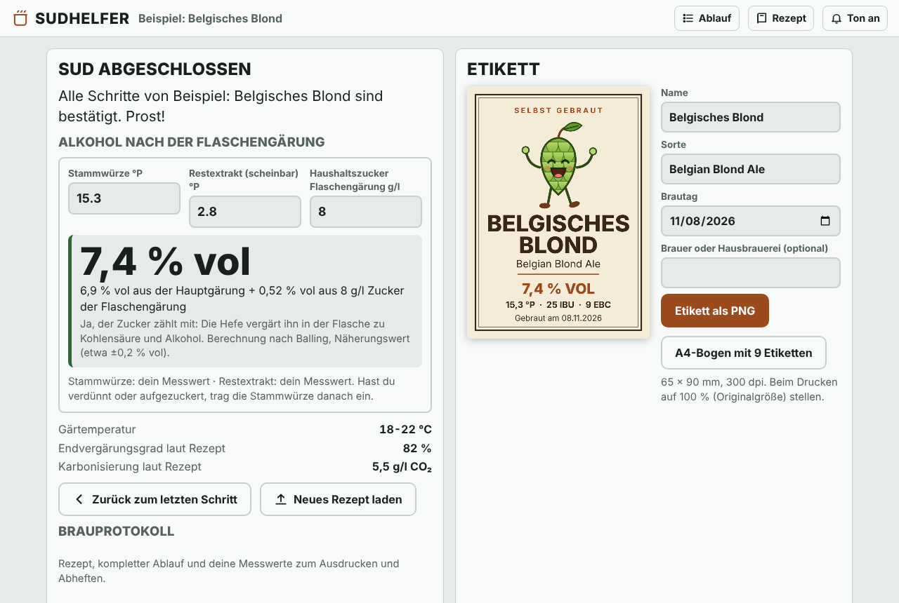

# Sudhelfer

🇩🇪 **Deutsch** · 🇬🇧 [English](README.en.md)

Web-Apps, die Hobbybrauer Schritt für Schritt durch einen Brautag im Einkochtopf führen: vom Einmaischen bis zum Abfüllen. Sie lesen Rezepte von [maischemalzundmehr.de](https://www.maischemalzundmehr.de/) sowie BeerXML- und BeerJSON-Dateien und machen daraus einen eindeutigen Ablauf mit gut lesbarer Anzeige der Zieltemperatur, Rühranzeige, Timern und Bestätigung jedes Schritts.

Es gibt zwei Varianten. Beide laufen auf Laptop, Tablet und Handy, lassen sich auf iPhone, iPad und Android als App auf den Home-Bildschirm legen und funktionieren danach auch offline. Sie speichern getrennt voneinander.

| | **Sudhelfer Einkochtopf** | **Sudhelfer Plus** |
|---|---|---|
| Online | **[danielmenzel.de/sudhelfer](https://danielmenzel.de/sudhelfer/)** | **[danielmenzel.de/sudhelfer-plus](https://danielmenzel.de/sudhelfer-plus/)** |
| Sprache | Deutsch | Deutsch und Englisch, Umschalter oben rechts |
| Rezept | laden und auf die eigene Sudgröße umrechnen | zusätzlich bearbeiten und speichern |
| Etikett | festes Design | eigenes Logo, Farben, Schrift, Rahmen, Größe |
| Quellcode | dieses Verzeichnis | [`plus/`](plus/) |

> **Hinweis:** Sudhelfer ist ein privates Hobby-Projekt. Es steht in keiner Verbindung zu maischemalzundmehr.de und ist kein offizielles Angebot der Seite. Die Rezepte stammen von den jeweiligen Autorinnen und Autoren.

## Sudhelfer Plus: was dazukommt

- **Zwei Sprachen:** Deutsch und Englisch, umschaltbar ohne Neuladen. Übersetzt sind auch Brauschritte, Rechner, Etikett und PDF-Protokoll.
- **Rezept bearbeiten:** Malz, Hopfen, weitere Zutaten, Stopfhopfen, Gärzutaten und Rasten ändern, entfernen und hinzufügen. Ausschlagwürze, Stammwürze, Alkohol, Bittere und Farbe rechnet die App laufend neu und zeigt „vorher → jetzt“.
- **Abhängigkeiten:** Die Ausschlagwürze folgt der Wasserbilanz (Hauptguss + Nachguss − Treberverlust − Verdampfung). Menge und Sudhausausbeute stellst du an einer Stelle in der Übersicht ein, das ganze Rezept wird umgerechnet.
- **Alphasäure:** Hat dein Hopfen einen anderen Alphasäurewert als im Rezept, passt die App die Grammzahl an, die Bittere bleibt gleich.
- **Rezept speichern:** als JSON-Datei, die sich wieder laden lässt. Das Original lässt sich wiederherstellen.
- **Etikett gestalten:** eigenes Logo, Farbvorlagen und freie Farben, Schriftart und Schriftgrößen, acht Rahmen, Etikettgröße und Anzahl auf dem A4-Bogen.
- **Sonstiges:** Brauvorgang jederzeit abbrechen (Klick auf „Sudhelfer“ oben links), Warnung bei heiß gemessener Stammwürze, Prüfung unplausibler Rezeptwerte.

**Rezept bearbeiten** mit laufend neu berechneten Werten:

**Etikett gestalten:**

**Englische Oberfläche** im Brau-Modus:

Die Rechenwege (Stammwürze aus der Extraktbilanz, Bittere nach Tinseth, Farbe nach Morey, Alkohol nach Balling) sind Näherungen und am geladenen Rezept abgeglichen. Malzfarben stehen nicht im Rezept-Export, die App setzt typische Werte ein, die sich überschreiben lassen.

## Herunterladen (Laptop und PC)

Jede Variante ist eine einzige HTML-Datei, die im Browser auch ohne Internet läuft:

- **[sudhelfer.html herunterladen](https://github.com/Zebrazeh/sudhelfer/releases/latest/download/sudhelfer.html)** (Sudhelfer Einkochtopf)
- **[sudhelfer-plus.html herunterladen](https://github.com/Zebrazeh/sudhelfer/releases/latest/download/sudhelfer-plus.html)** (Sudhelfer Plus)

## So sieht es aus (Sudhelfer Einkochtopf)

**Übersicht** nach dem Laden eines Rezepts (Laptop):

**Brau-Modus** (Handy): links eine Rast mit Anzeige der Zieltemperatur, Rühranzeige und Timer, rechts der Stammwürze-Rechner mit Mischkreuz.

&nbsp;&nbsp;

**Hopfengabe beim Kochen** (Tablet quer):

**Nach dem Abfüllen:** Alkoholgehalt nach der Flaschengärung berechnen und Flaschenetikett drucken:

## Funktionen (beide Varianten)

- **Rezepte laden**
  - JSON-Export von maischemalzundmehr.de (Exportversion 1 und 2, auch Dekoktion)
  - QR-Code einer Rezeptseite von maischemalzundmehr.de fotografieren, dann führt die App zum passenden JSON-Export
  - BeerXML 1.0 (z. B. aus BeerSmith, Brewfather, Kleiner Brauhelfer, Brewer's Friend)
  - BeerJSON 1.0
- **Übersicht:** Kennzahlen, Phasen, Maischplan-Diagramm, Kochplan mit Zugabezeitpunkten, Umrechnen auf die eigene Sudgröße
- **Brau-Modus:** große Anzeige der Zieltemperatur mit Hinweis, was zu tun ist (Heizen, Halten, Kochen, Kühlen, Aus), Anzeige ob gerührt wird, Timer mit Ton, jeder Schritt mit Häkchen und OK bestätigt, Zurückgehen jederzeit möglich
- **Ablauf bis zum Schluss:** Vorbereitung, Maischen mit Jodprobe, Läutern, Kochen, Whirlpool, Abkühlen ohne aktive Kühlung, Anstellen, Hauptgärung, Hopfenstopfen, Endvergärung, Abfüllen, Nachgärung
- **Rechner:** Stammwürze mit Temperaturkorrektur und Mischkreuz (Verdünnen oder Aufzuckern), Zucker für die Flaschengärung, Alkoholgehalt nach der Flaschengärung
- **Ausgabe:** Brauprotokoll als PDF zum Ausdrucken, Flaschenetikett als PNG (einzeln oder A4-Bogen)
- Fortschritt, Timer und Eingaben werden im Browser gespeichert. Ein Neuladen der Seite ist sicher.

## Benutzung

### iPhone und iPad

1. In **Safari** [danielmenzel.de/sudhelfer](https://danielmenzel.de/sudhelfer/) oder [danielmenzel.de/sudhelfer-plus](https://danielmenzel.de/sudhelfer-plus/) öffnen.
2. Auf **Teilen** tippen (Quadrat mit Pfeil nach oben), dann **„Zum Home-Bildschirm“** und **„Hinzufügen“**.
3. Den Sudhelfer einmal über das neue Symbol mit Internet öffnen. Ab dann startet er auch ohne Netz, zum Beispiel in der Garage oder im Keller.

Gut zu wissen:

- Die heruntergeladenen Dateien `sudhelfer.html` und `sudhelfer-plus.html` funktionieren auf iPhone und iPad **nicht**. iOS zeigt lokale HTML-Dateien nur in einer Vorschau ohne JavaScript an, die Seite bleibt leer. Deshalb den Weg über die Links oben nehmen.
- Während eines Brauschritts bleibt der Bildschirm an. Für den Timer-Ton oben auf **„Ton an“** tippen und den Stummschalter am Gerät prüfen.
- Die App auf dem Home-Bildschirm und Safari speichern getrennt. Ein Sud, der in Safari begonnen wurde, ist im Home-Bildschirm-Symbol nicht zu sehen. Am besten immer dasselbe benutzen.
- Vor dem ersten Brautag einmal im Flugmodus testen, ob der Sudhelfer startet.

### Android

1. In **Chrome** [danielmenzel.de/sudhelfer](https://danielmenzel.de/sudhelfer/) oder [danielmenzel.de/sudhelfer-plus](https://danielmenzel.de/sudhelfer-plus/) öffnen.
2. Über das Menü (drei Punkte) **„Zum Startbildschirm hinzufügen“** bzw. **„App installieren“** wählen.
3. Einmal mit Internet öffnen, danach läuft er auch offline.

### Laptop und PC

- Entweder die Online-Version im Browser öffnen
- oder die HTML-Datei herunterladen (siehe oben) und per Doppelklick im Browser öffnen. Die Datei läuft komplett offline.

### Brauen

1. Rezept laden: Datei wählen, Text einfügen oder QR-Code scannen.
2. Übersicht prüfen, die Hinweise zum Rezept lesen, auf **Start** tippen.
3. Jeden Schritt abarbeiten, abhaken und mit **OK** bestätigen.

Zum Ausprobieren lädt die App beim ersten Öffnen ein selbst zusammengestelltes Beispielrezept (Belgisches Blond). Weitere Beispieldateien liegen in [`examples/`](examples/).

## Sicherheit

Flaschengärung kann gefährlich sein: Zu viel Zucker oder nicht endvergorenes Bier erzeugt in der Flasche zu viel Druck, Flaschen können platzen. Die Rezepte auf Rezeptseiten sind ungeprüfte Hobby-Rezepte und können Fehler enthalten. Alle Werte der App sind Näherungen ohne Gewähr. **Du braust auf eigene Verantwortung.**

## Datenschutz

Rezepte, Messwerte und Fortschritt bleiben im Browser auf deinem Gerät. Die App schickt nichts an einen Server und lädt nichts von fremden Adressen nach. Einzige Ausnahme ist der Link „JSON-Export öffnen“ zu maischemalzundmehr.de, den du selbst antippst. Für die Online-Version unter danielmenzel.de gelten Impressum und Datenschutzerklärung, die in der App verlinkt sind.

## Aufbau des Quellcodes

| Datei | Inhalt |
|---|---|
| `index.html` | fertige App als eine Datei, wird von `build.py` erzeugt (dieselbe Datei wie der Download) |
| `src/app.html` | Oberfläche, Stile, Rechner, PDF- und Etikett-Erzeugung |
| `src/core.js` | Rezept-Import (maischemalzundmehr.de, BeerXML, BeerJSON) und Erzeugung der Brauschritte |
| `vendor/jsQR-1.4.0.js` | QR-Erkennung, unverändert übernommen |
| `web/` | Zusatzdateien für die Online-Version: Service Worker (`sw.js`) für den Offline-Betrieb, Manifest und Icons für den Home-Bildschirm |
| `build.py` | baut die App aus den Teilen zusammen |
| `examples/` | Beispielrezepte in allen drei Formaten |
| `plus/` | Sudhelfer Plus: eigener Quellcode (`src/`), eigenes `build.py`, eigener Service Worker und eigenes Manifest (`web/`), fertige App als `plus/index.html`. QR-Erkennung und Icons werden aus `vendor/` und `web/` mitbenutzt. |

**Eine Datei bauen:** `python3 build.py` erzeugt `index.html`.

**Eigene Online-Version bauen:** `python3 build.py --web ZIELORDNER --legal-url https://example.org/impressum` erzeugt im Zielordner `index.html`, `sw.js`, `manifest.webmanifest` und drei Icons. Diese sechs Dateien gemeinsam in einen Ordner auf dem eigenen Webspace legen. Der Webspace braucht **HTTPS**, sonst laufen Offline-Betrieb und „Bildschirm bleibt an“ nicht. `--legal-url` setzt in der App einen Link „Impressum & Datenschutz“. Bei jeder neuen Version alle sechs Dateien neu hochladen.

**Sudhelfer Plus bauen:** dieselben Befehle im Ordner `plus/`, also `python3 plus/build.py` bzw. `python3 plus/build.py --web ZIELORDNER --legal-url URL`. Plus braucht einen eigenen Ordner auf dem Webspace.

## Lizenz

© 2026 Daniel Menzel. Veröffentlicht unter der [MIT-Lizenz](LICENSE). Erstellt mit Unterstützung von Claude (Anthropic).

Enthaltene Fremdsoftware: [jsQR](https://github.com/cozmo/jsQR) 1.4.0 unter der Apache License 2.0, siehe [THIRD-PARTY-NOTICES.txt](THIRD-PARTY-NOTICES.txt).
