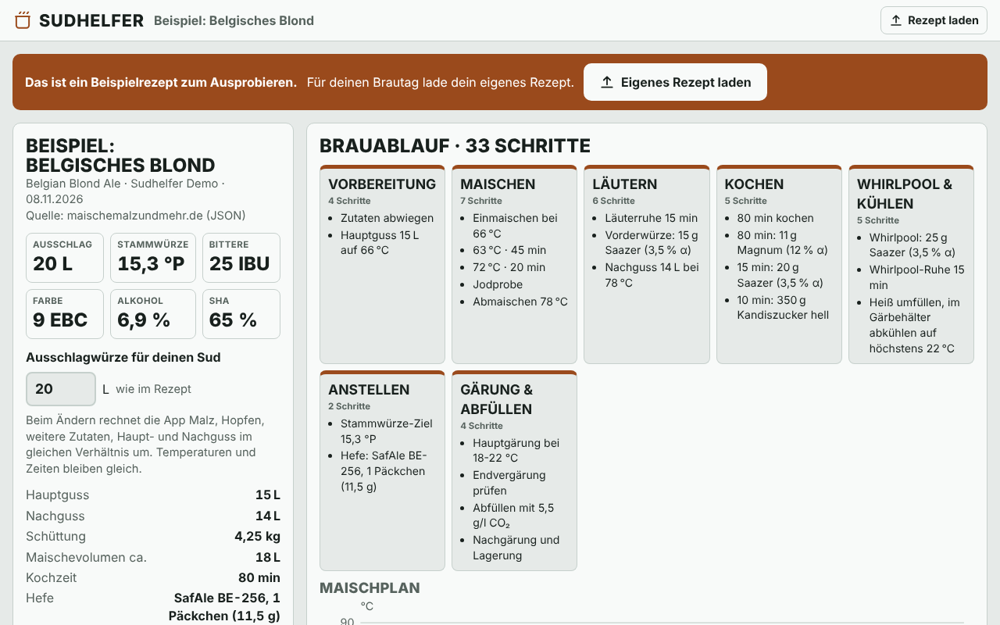
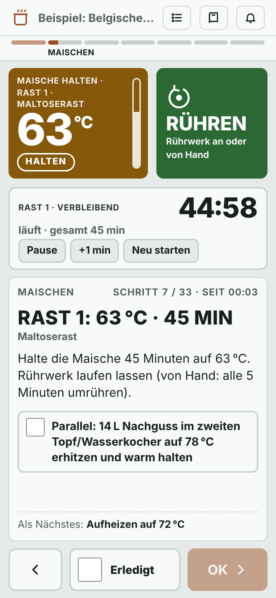
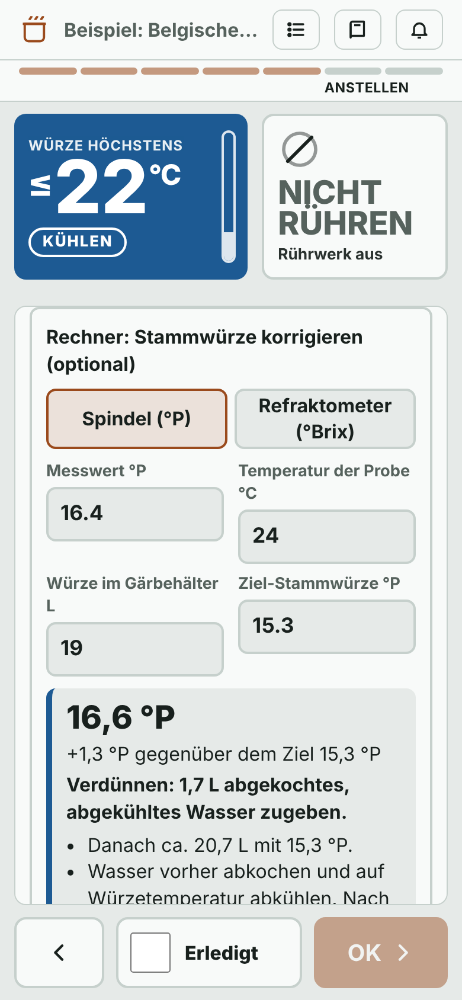
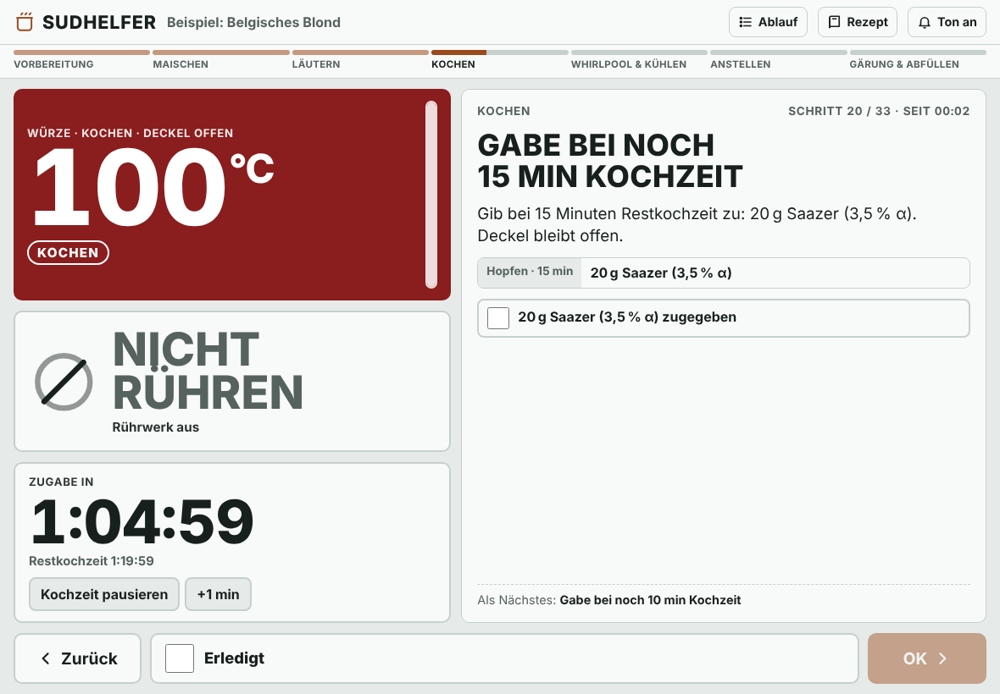
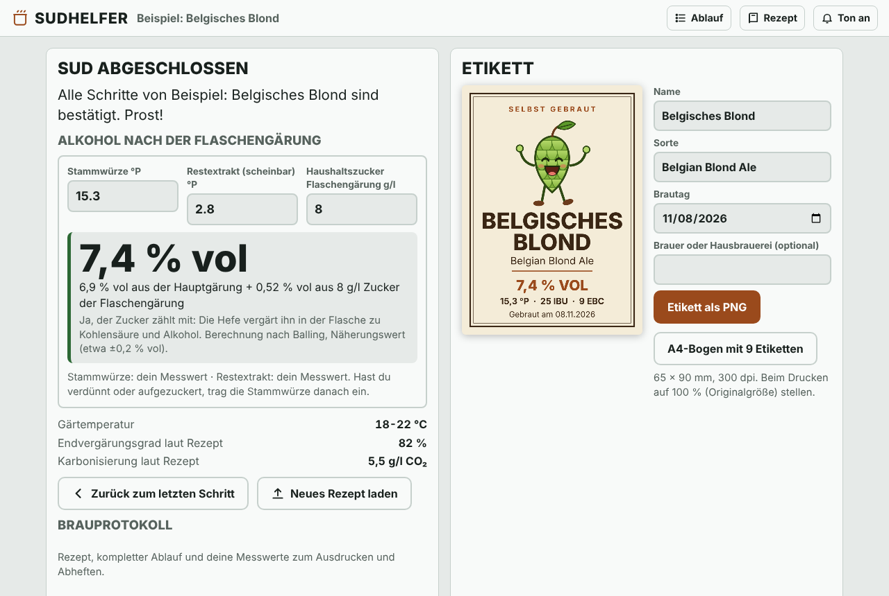

# Sudhelfer Einkochtopf

Eine Web-App, die Hobbybrauer Schritt für Schritt durch einen Brautag im Einkochtopf führt: vom Einmaischen bis zum Abfüllen. Sie liest Rezepte von [maischemalzundmehr.de](https://www.maischemalzundmehr.de/) sowie BeerXML- und BeerJSON-Dateien und macht daraus einen eindeutigen Ablauf mit gut lesbarer Anzeige der Zieltemperatur, Rühranzeige, Timern und Bestätigung jedes Schritts.

Die ganze App ist **eine einzige HTML-Datei** (`index.html`). Sie läuft im Browser auf Laptop, Tablet und Handy, auch offline, und ruft von sich aus keine externen Adressen auf.

> **Hinweis:** Sudhelfer ist ein privates Hobby-Projekt. Es steht in keiner Verbindung zu maischemalzundmehr.de und ist kein offizielles Angebot der Seite. Die Rezepte stammen von den jeweiligen Autorinnen und Autoren.

## So sieht es aus

**Übersicht** nach dem Laden eines Rezepts (Laptop):

**Brau-Modus** (Handy): links eine Rast mit Anzeige der Zieltemperatur, Rühranzeige und Timer, rechts der Stammwürze-Rechner mit Mischkreuz.

&nbsp;&nbsp;

**Hopfengabe beim Kochen** (Tablet quer):

**Nach dem Abfüllen:** Alkoholgehalt nach der Flaschengärung berechnen und Flaschenetikett drucken:

## Funktionen

- **Rezepte laden**
  - JSON-Export von maischemalzundmehr.de (Exportversion 1 und 2, auch Dekoktion)
  - QR-Code einer Rezeptseite von maischemalzundmehr.de fotografieren, dann führt die App zum passenden JSON-Export
  - BeerXML 1.0 (z. B. aus BeerSmith, Brewfather, Kleiner Brauhelfer, Brewer's Friend)
  - BeerJSON 1.0
- **Übersicht:** Kennzahlen, Phasen, Maischplan-Diagramm, Kochplan mit Zugabezeitpunkten, Umrechnen auf die eigene Sudgröße
- **Brau-Modus:** große Anzeige der Zieltemperatur mit Hinweis, was zu tun ist (Heizen, Halten, Kochen, Kühlen, Aus), Anzeige ob gerührt wird, Timer mit Ton, jeder Schritt mit Häkchen und OK bestätigt, Zurückgehen jederzeit möglich
- **Ablauf bis zum Schluss:** Vorbereitung, Maischen mit Jodprobe, Läutern, Kochen, Whirlpool, Abkühlen ohne aktive Kühlung, Anstellen, Hauptgärung, Hopfenstopfen, Endvergärung, Abfüllen, Nachgärung
- **Rechner:** Stammwürze mit Temperaturkorrektur und Mischkreuz (Verdünnen oder Aufzuckern), Zucker für die Flaschengärung, Alkoholgehalt nach der Flaschengärung
- **Ausgabe:** Brauprotokoll als PDF zum Ausdrucken, Flaschenetikett als PNG (einzeln oder A4-Bogen)
- Fortschritt, Timer und Eingaben werden im Browser gespeichert. Ein Neuladen der Seite ist sicher.

## Benutzung

1. `index.html` herunterladen und im Browser öffnen.
2. Rezept laden: Datei wählen, Text einfügen oder QR-Code scannen.
3. Übersicht prüfen, die Hinweise zum Rezept lesen, auf **Start** tippen.

Zum Ausprobieren lädt die App beim ersten Öffnen ein selbst zusammengestelltes Beispielrezept (Belgisches Blond). Weitere Beispieldateien liegen in [`examples/`](examples/).

## Sicherheit

Flaschengärung kann gefährlich sein: Zu viel Zucker oder nicht endvergorenes Bier erzeugt in der Flasche zu viel Druck, Flaschen können platzen. Die Rezepte auf Rezeptseiten sind ungeprüfte Hobby-Rezepte und können Fehler enthalten. Alle Werte der App sind Näherungen ohne Gewähr. **Du braust auf eigene Verantwortung.**

## Aufbau des Quellcodes

| Datei | Inhalt |
|---|---|
| `index.html` | fertige App (wird von `build.py` erzeugt) |
| `src/app.html` | Oberfläche, Stile, Rechner, PDF- und Etikett-Erzeugung |
| `src/core.js` | Rezept-Import (maischemalzundmehr.de, BeerXML, BeerJSON) und Erzeugung der Brauschritte |
| `vendor/jsQR-1.4.0.js` | QR-Erkennung, unverändert übernommen |
| `build.py` | setzt `index.html` aus den Teilen zusammen: `python3 build.py` |
| `examples/` | Beispielrezepte in allen drei Formaten |

## Lizenz

© 2026 Daniel Menzel. Veröffentlicht unter der [MIT-Lizenz](LICENSE). Erstellt mit Unterstützung von Claude (Anthropic).

Enthaltene Fremdsoftware: [jsQR](https://github.com/cozmo/jsQR) 1.4.0 unter der Apache License 2.0, siehe [THIRD-PARTY-NOTICES.txt](THIRD-PARTY-NOTICES.txt).
